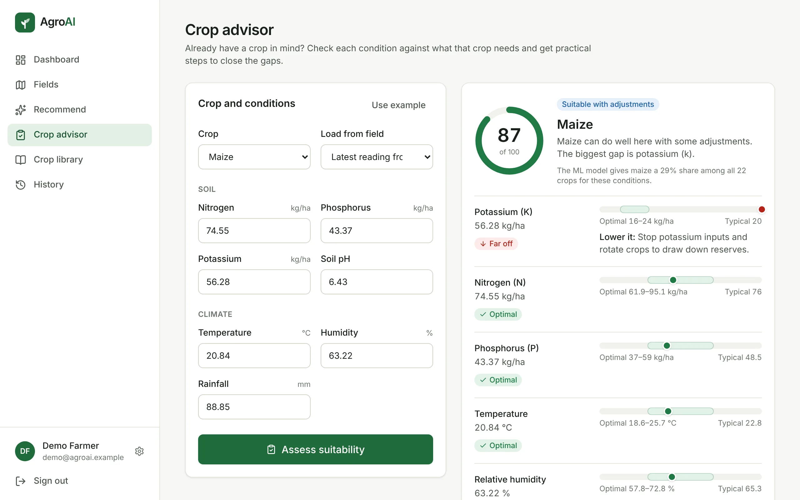

# AgroAI

**Crop recommendations, agronomic advice and field monitoring for smallholder farmers in Lesotho.**

AgroAI turns a soil test and local weather into planting decisions. It ranks the crops most likely
to thrive on a field, explains which conditions fall short for a chosen crop and what to do about
each one, and tracks every planting from sowing to harvest.


## Features

| | |
|---|---|
| **Crop recommendations** | A Random Forest model ranks 22 crops from seven soil and climate measurements (99.3% held-out accuracy). Every result shows the model's confidence and warns when inputs fall outside anything it was trained on. |
| **Crop advisor** | Pick a crop and see each condition against that crop's optimal range, a 0–100 suitability score, and specific corrective actions (liming, irrigation, fertiliser, and so on). |
| **Field monitoring** | Map fields, record readings by hand or simulate IoT sensor streams, and chart any measurement over time. |
| **Crop tracking** | Follow each planting through its growth stages with guidance for the current stage, expected harvest date, and harvest and yield records. |
| **History** | Every recommendation is stored with its inputs and the model version that produced it. |

<table>
  <tr>
    <td></td>
    <td></td>
  </tr>
</table>

## Quick start

### With Docker (recommended)

```bash
cp .env.example .env
```

Set `AGROAI_SECRET_KEY` in `.env` to a long random value
(`python -c "import secrets; print(secrets.token_urlsafe(48))"`), then:

```bash
docker compose up --build
```

Open <http://localhost:8080>. The interactive API docs are at <http://localhost:8000/docs>.
The model is trained while the API image builds, and migrations run when the API starts.

To explore with sample data, create the demo account
(`demo@agroai.example` / `agroai-demo-1`):

```bash
docker compose exec api python -m app.seed
```

### For development

Requires Python 3.12+, [uv](https://docs.astral.sh/uv/), Node.js 22+ and PostgreSQL 16.

```bash
make install                      # backend and frontend dependencies
cp backend/.env.example backend/.env
make train                        # train the model (about 10 seconds)
make migrate                      # create the database schema
make seed                         # optional demo account
make api                          # http://localhost:8000 (terminal 1)
make web                          # http://localhost:5173 (terminal 2)
```

The development web server proxies `/api` to the backend, so no CORS setup is needed.
Run `make help` for every task.

## Project layout

```
backend/            FastAPI service (Python)
  app/api/          HTTP routes, dependencies and response mapping
  app/services/     Advisory engine, growth tracking, sensor simulator, crop catalogue
  app/ml/           Dataset loading, training pipeline, model wrapper
  app/models/       SQLAlchemy models          app/schemas/   Pydantic request/response schemas
  app/data/         Crop metadata and data-derived condition profiles
  alembic/          Database migrations        tests/         pytest suite
frontend/           React + TypeScript single-page app (Vite, Tailwind CSS)
  src/pages/        Screens                    src/components/  UI kit and domain components
  src/lib/          API client, React Query hooks, formatting
docs/               Architecture, model card and API reference
```

## Quality

| Check | Command |
|---|---|
| Backend tests (SQLite or PostgreSQL) | `cd backend && uv run pytest --cov` |
| Frontend tests | `cd frontend && npm test` |
| Lint, format and strict type checks | `make lint` |
| Everything CI runs | `make check` |

CI runs all of the above against PostgreSQL, verifies migrations match the models and round-trip
cleanly, retrains the model, and builds both Docker images.

## Documentation

- [Architecture](docs/architecture.md): components, data model, request flow and design decisions
- [Model card](docs/model-card.md): data, training, evaluation, limitations and intended use
- [API reference](docs/api.md): endpoints at a glance (the full schema is served at `/docs`)
- [Contributing](CONTRIBUTING.md): setup, conventions and workflow

## Limitations

AgroAI is decision support, not a substitute for local agronomic expertise. The model is trained
on a public dataset that is not specific to Lesotho and includes tropical crops (coconut, coffee,
jute) that are unsuitable for most of the country. See the [model card](docs/model-card.md) for
details.

## Credits

AgroAI began as a final-year B.Sc. Computer Science project at the **National University of
Lesotho**, Department of Mathematics and Computer Science (2025).

- **Authors:** Tlotliso Khosi and Keketso Tolo
- **Supervisor:** Mx. Mathe Ntšekhe · **Co-supervisor:** Dr. Lerato Lerato
- **Agricultural domain expertise:** Ms. Moipone Sebitia
- Crop dataset: [Crop Recommendation Dataset](https://www.kaggle.com/datasets/atharvaingle/crop-recommendation-dataset) (Kaggle)
- Map data © [OpenStreetMap](https://www.openstreetmap.org/copyright) contributors

## Licence

No licence has been chosen yet. Until one is added, the original project's terms apply: use is
permitted for educational and non-commercial purposes with attribution.
