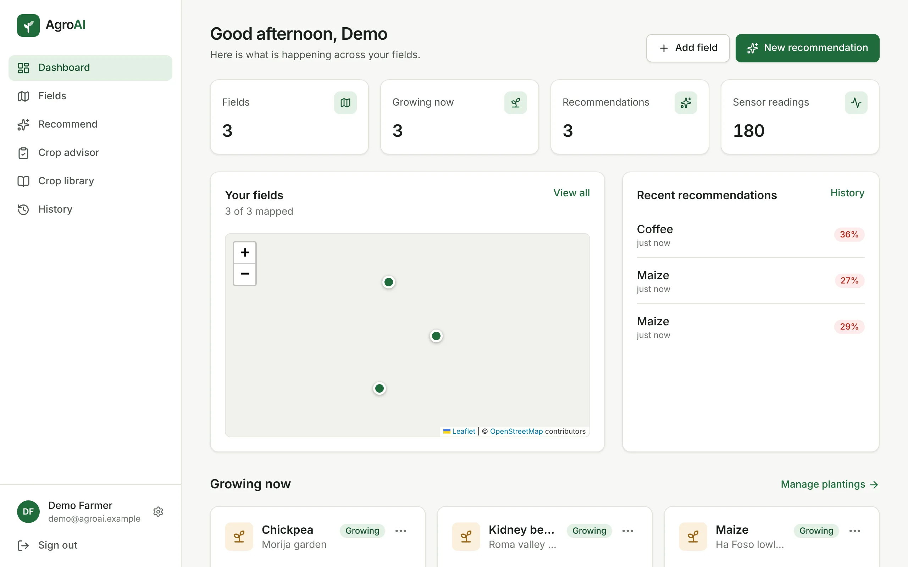
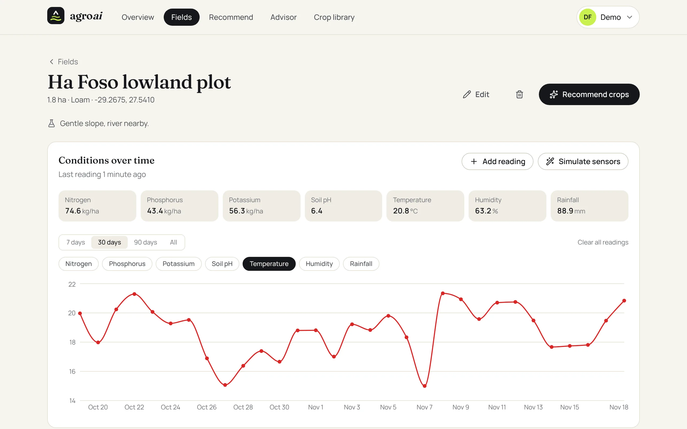

# AgroAI

**Crop recommendations, agronomic advice and field monitoring for smallholder farmers in Lesotho.**

AgroAI turns a soil test and local weather into planting decisions. It ranks the crops most likely
to thrive on a field, explains which conditions fall short for a chosen crop and what to do about
each one, and tracks every planting from sowing to harvest.

**Live pilot: https://kenttolo.github.io/AgroAI-Version2/** (create an account to start; the API
runs on Render's free tier, so the first request after a quiet spell takes up to a minute)



## Features

| | |
|---|---|
| **Crop recommendations** | A Random Forest model ranks crops from seven soil and climate measurements (99.3% held-out accuracy). By default it ranks only crops grown in Lesotho, and scores the staples it has no data for (sorghum, wheat, dry peas, potatoes) with the crop advisor. Every result shows the model's confidence and warns when inputs fall outside anything it was trained on. |
| **Crop advisor** | Pick a crop and see each condition against that crop's optimal range, a 0–100 suitability score, and specific corrective actions (liming, irrigation, fertiliser, and so on). |
| **Field monitoring** | Map fields on a street or satellite map (pick a spot or use your phone's location), record readings by hand or simulate IoT sensor streams, and chart any measurement over time. |
| **Crop tracking** | Follow each planting through its growth stages with guidance for the current stage, expected harvest date, and harvest and yield records. |
| **Weather and climate feed** | Each mapped field syncs up to 10 years of daily weather from [Open-Meteo](https://open-meteo.com) plus a 7-day forecast. Recommendations can use recent weather or the typical climate for the season you plan to plant. |
| **Sensor stations** | A low-cost ESP32 station (under M1,000, [build manual](docs/hardware/README.md)) posts air and soil readings every 15 minutes with its own API key. |
| **Admin dashboard** | Accounts listed in `AGROAI_ADMIN_EMAILS` see system-wide usage: users, fields, stations and recommendations. |
| **History** | Every recommendation is stored with its inputs, climate basis and the model version that produced it. |

<table>
  <tr>
    <td></td>
    <td></td>
  </tr>
</table>

## Quick start

### With Docker (recommended)

```bash
cp .env.example .env
```

Set `AGROAI_SECRET_KEY` in `.env` to a long random value
(`python -c "import secrets; print(secrets.token_urlsafe(48))"`), then:

```bash
docker compose up --build
```

Open <http://localhost:8080>. The interactive API docs are at <http://localhost:8000/docs>.
The model is trained while the API image builds, and migrations run when the API starts.

To explore with sample data, create the demo account
(`demo@agroai.example` / `agroai-demo-1`):

```bash
docker compose exec api python -m app.seed
```

### For development

Requires Python 3.12+, [uv](https://docs.astral.sh/uv/), Node.js 22+ and PostgreSQL 16.

```bash
make install                      # backend and frontend dependencies
cp backend/.env.example backend/.env
make train                        # train the model (about 10 seconds)
make migrate                      # create the database schema
make seed                         # optional demo account
make api                          # http://localhost:8000 (terminal 1)
make web                          # http://localhost:5173 (terminal 2)
```

The development web server proxies `/api` to the backend, so no CORS setup is needed.
Run `make help` for every task.

### Browser-only demo (GitHub Pages)

The [Pages workflow](.github/workflows/pages.yml) publishes the web app on every push to `main`,
connected to the pilot API. With the repository variable `AGROAI_DEMO=true` it instead publishes a
browser-only demo, which answers API requests inside the browser
([`frontend/src/demo`](frontend/src/demo)): the trained Random Forest is exported to JSON and
evaluated in JavaScript (the backend tests check that its predictions match scikit-learn
exactly), and the advisory, growth and simulator rules are exported from the Python services.
Each visitor's data lives in their own browser's storage.

Run the same build locally with `make demo`.

## Project layout

```
backend/            FastAPI service (Python)
  app/api/          HTTP routes, dependencies and response mapping
  app/services/     Advisory engine, growth tracking, sensor simulator, crop catalogue
  app/ml/           Dataset loading, training pipeline, model wrapper
  app/models/       SQLAlchemy models          app/schemas/   Pydantic request/response schemas
  app/data/         Crop metadata and data-derived condition profiles
  alembic/          Database migrations        tests/         pytest suite
firmware/           ESP32 sensor station firmware (Arduino / PlatformIO)
frontend/           React + TypeScript single-page app (Vite, Tailwind CSS)
  src/demo/         In-browser API used by the GitHub Pages demo
  src/pages/        Screens                    src/components/  UI kit and domain components
  src/lib/          API client, React Query hooks, formatting
docs/               Architecture, model card and API reference
```

## Quality

| Check | Command |
|---|---|
| Backend tests (SQLite or PostgreSQL) | `cd backend && uv run pytest --cov` |
| Frontend tests | `cd frontend && npm test` |
| Lint, format and strict type checks | `make lint` |
| Everything CI runs | `make check` |

CI runs all of the above against PostgreSQL, verifies migrations match the models and round-trip
cleanly, retrains the model, and builds both Docker images.

## Documentation

- [Pilot deployment](docs/deployment/pilot.md): go live on Supabase, Render and GitHub Pages (free tiers)
- [Sensor station manual](docs/hardware/README.md): parts list, wiring, firmware, calibration and installation
- [Architecture](docs/architecture.md): components, data model, request flow and design decisions
- [Model card](docs/model-card.md): data, training, evaluation, limitations and intended use
- [API reference](docs/api.md): endpoints at a glance (the full schema is served at `/docs`)
- [Contributing](CONTRIBUTING.md): setup, conventions and workflow

## Limitations

AgroAI is decision support, not a substitute for local agronomic expertise. The model is trained
on a public dataset that is not specific to Lesotho and includes tropical crops (coconut, coffee,
jute) that are unsuitable for most of the country. These are tagged "not suited to Lesotho" and left
out of recommendations by default. Lesotho staples missing from the dataset (sorghum, wheat, dry
peas, potatoes) use approximate ranges from published guides
([`crop_profiles_literature.json`](backend/app/data/crop_profiles_literature.json)) and are
scored by the advisor, not the model. See the [model card](docs/model-card.md) for
details.

## Credits

AgroAI began as a final-year B.Sc. Computer Science project at the **National University of
Lesotho**, Department of Mathematics and Computer Science (2025).

- **Authors:** Tlotliso Khosi and Keketso Tolo
- **Supervisor:** Mx. Mathe Ntšekhe · **Co-supervisor:** Dr. Lerato Lerato
- **Agricultural domain expertise:** Ms. Moipone Sebitia
- Crop dataset: [Crop Recommendation Dataset](https://www.kaggle.com/datasets/atharvaingle/crop-recommendation-dataset) (Kaggle)
- Maps: [MapLibre GL JS](https://maplibre.org); map tiles by [OpenFreeMap](https://openfreemap.org) © [OpenMapTiles](https://openmaptiles.org), data © [OpenStreetMap](https://www.openstreetmap.org/copyright) contributors; satellite imagery powered by Esri (Esri, Maxar, Earthstar Geographics and the GIS User Community). Map sources chosen with the help of [God's Eye View](https://github.com/bilawalsidhu/gods-eye-view)'s data-source catalogue.

## Licence

No licence has been chosen yet. Until one is added, the original project's terms apply: use is
permitted for educational and non-commercial purposes with attribution.
